# Muhammad Daffa Najib Fikri

Full-stack developer and student at Politeknik IDN Bogor. I build web applications across the UI, API, and database, with recent work in café operations, digital publishing, and interactive web experiences.

[Selected work](#selected-work) · [Toolkit](#technical-toolkit) · [Experience](#experience) · [Contact](#contact)

## Selected work

### Kopora · Café point of sale

A café POS in development. The backend handles orders, menu data, and cash and QRIS payment flows. The current web client includes sign-in and a live barista board for progressing and archiving tickets.

`React` `TypeScript` `Express` `Prisma` `PostgreSQL` `Socket.IO`

[Explore the repository](https://github.com/daffa102/apps-kasir-dumbways)

### Interupsi · News publishing

A news portal with an editorial workflow for writing, publishing, and managing articles.

`Laravel` `Blade` `Livewire` `Filament`

[Visit Interupsi](https://interupsi.co.id/)

### Alibi · Call simulation

A web app that simulates incoming calls using scenario audio. The project includes Supabase sign-in and a Midtrans checkout integration.

`Next.js` `TypeScript` `Supabase` `Midtrans`

[Explore the repository](https://github.com/daffa102/alibi--app)

### Cibaduy · Company profile

A company profile website built with Next.js during my internship at SultanTV.

`Next.js`

[Visit Cibaduy](https://cibaduy.com/)

## Technical toolkit

- **Frontend** · TypeScript, React, Next.js, Tailwind CSS
- **Backend** · Express, PHP, Laravel, REST APIs, Socket.IO
- **Data** · PostgreSQL, MySQL, Prisma, Supabase
- **Development** · Git, GitHub, Zod

## Experience

**Full Stack Developer Intern · PT DumbWays Indonesia**  
Oct–Dec 2026 · Worked on Kopora and Alibi across frontend and backend.

**Full Stack Developer Intern · SultanTV**  
Jul–Sep 2026 · Built the Interupsi news portal and the Cibaduy company profile.

## Contact

[LinkedIn](https://www.linkedin.com/in/muhammad-daffa-najib-fikri/) · [Portfolio](https://dappa.my.id/)
