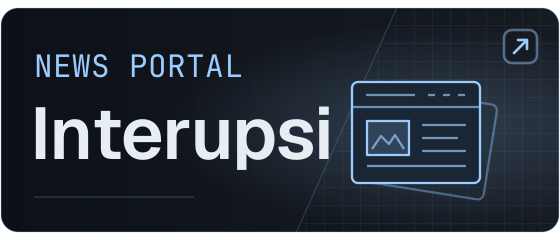
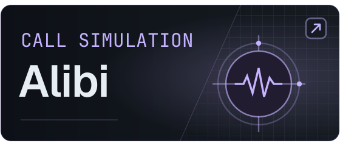
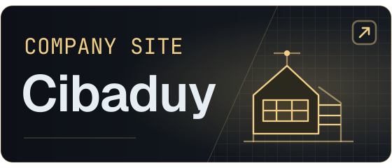

<picture>
  <source media="(prefers-color-scheme: light)" srcset="https://raw.githubusercontent.com/daffa102/daffa102/main/assets/engineering/hero-light.svg">
  
</picture>

I build web apps from interface to database. I’m a student at Politeknik IDN Bogor with full-stack internship experience at DumbWays Indonesia and SultanTV.

[Selected work](#selected-work) · [Toolkit](#technical-toolkit) · [Experience](#experience) · [Contact](#contact)

## Selected work

<a href="https://github.com/daffa102/apps-kasir-dumbways"><picture><source media="(max-width: 600px)" srcset="https://raw.githubusercontent.com/daffa102/daffa102/main/assets/engineering/kopora-mobile.svg"></picture></a>

**Kopora** · A café POS in development. The Express API handles orders, menus, and cash or QRIS payment flows. A live barista board tracks paid tickets through preparation and pickup.  
`React` `TypeScript` `Express` `Prisma` `PostgreSQL` `Socket.IO`

  
  
  

- **[Interupsi](https://interupsi.co.id/)** · News portal with an editorial publishing workflow. `Laravel` `Livewire` `Filament`
- **[Alibi](https://github.com/daffa102/alibi--app)** · Incoming-call simulation with scenario audio. `Next.js` `Supabase` `Midtrans`
- **[Cibaduy](https://cibaduy.com/)** · Company profile website built at SultanTV. `Next.js`

## Technical toolkit

 &nbsp; **Frontend** · TypeScript, React, Next.js, Tailwind CSS

 &nbsp; **Backend** · Express, PHP, Laravel, REST APIs, Socket.IO

 &nbsp; **Data & tools** · PostgreSQL, MySQL, Prisma, Supabase, Git, Zod

## Experience

> **SultanTV** · Full Stack Developer Intern · Jul–Sep 2026  
> Built the Interupsi news portal and Cibaduy company profile.

> **PT DumbWays Indonesia** · Full Stack Developer Intern · Oct–Dec 2026  
> Worked on Kopora and Alibi across frontend and backend.

## Contact

[LinkedIn](https://www.linkedin.com/in/muhammad-daffa-najib-fikri/) · [GitHub repositories](https://github.com/daffa102?tab=repositories)
