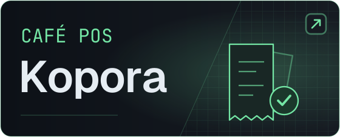
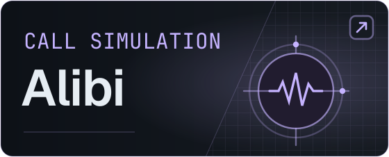
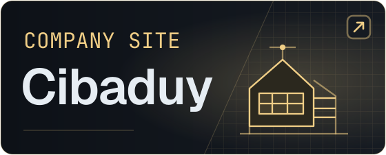

I build web apps from interface to database. I’m a student at Politeknik IDN Bogor with internship experience at DumbWays Indonesia and SultanTV.

[LinkedIn](https://www.linkedin.com/in/muhammad-daffa-najib-fikri/) · [Portfolio](https://dappa.my.id/)

## Selected work

  
  

  
  

Project details and stack

- **Kopora** · Café POS in development with an order and payment API and a live barista board. React, Express, Prisma, Socket.IO.
- **Interupsi** · News portal for drafting, publishing, and managing articles. Laravel, Livewire, Filament.
- **Alibi** · Incoming-call simulation with scenario audio, Supabase sign-in, and Midtrans checkout. Next.js, Supabase, Midtrans.
- **Cibaduy** · Company profile website built during my internship at SultanTV. Next.js.

## Technical toolkit

**Frontend** · TypeScript, React, Next.js, Tailwind CSS  
**Backend** · Express, PHP, Laravel, REST APIs, Socket.IO  
**Data and tools** · PostgreSQL, MySQL, Prisma, Supabase, Git, Zod

## Experience

**PT DumbWays Indonesia** · Full Stack Developer Intern · Oct–Dec 2026  
Worked on Kopora and Alibi across frontend and backend.

**SultanTV** · Full Stack Developer Intern · Jul–Sep 2026  
Built the Interupsi news portal and Cibaduy company profile.
